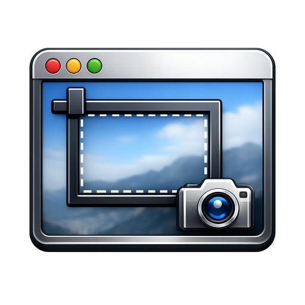

<p align="center">
  
</p>

<h1 align="center">ZigIt</h1>

<p align="center">
  <strong>Fast screenshots, clipboard handoff, and annotation for Wayland.</strong>
</p>

<p align="center">
  A Zig and Dear ImGui screenshot workflow for Linux: capture a screen or
  window, save a PNG, copy it, and continue in a lightweight editor.
</p>

ZigIt is a Wayland-first alternative to capture tools that stop after writing
a file. A daemon keeps recent screenshots visible, settings stay in a plain
TOML file, and one binary provides capture, editing, and compositor setup.

Current release: **0.3.0**.

## Why ZigIt?

- **One capture flow:** save, copy to the clipboard, and open the editor.
- **Useful editing tools:** crop, arrows, rectangles, pen, text, blur,
  numbered steps, undo, and redo.
- **Recent captures:** the daemon watches the capture directory and displays
  clickable thumbnails.
- **Wayland integration:** native setup for Sway, Hyprland, River, Labwc, and
  KDE Plasma. KDE uses its system capture backend when wlr-screencopy is unavailable.
- **Conflict-aware KDE hotkeys:** ZigIt identifies the current shortcut owner,
  can replace the existing screenshot binding, and restores it when ZigIt is uninstalled.
- **Plain configuration:** preferences live at
  `~/.config/zigit/config.toml` or `$XDG_CONFIG_HOME/zigit/config.toml`.

## Install from AUR

On Arch Linux and derivatives (CachyOS, EndeavourOS, Manjaro, …), install the
[`zigit`](https://aur.archlinux.org/packages/zigit) package with an AUR helper:

```bash
paru -S zigit
# or
yay -S zigit
```

That pulls the tagged release from GitHub and builds it with the system Zig
toolchain. After install, the binary is on your `PATH` as `zigit`:

```bash
zigit --version
zigit setup --dry-run
zigit daemon
```

Without a helper, clone and build the package by hand:

```bash
git clone https://aur.archlinux.org/zigit.git
cd zigit
makepkg -si
```

## Build from source

ZigIt requires Zig 0.16.0, a C++ toolchain, GLFW, Wayland, EGL/GLESv2,
xkbcommon, and `wl-copy`. KDE capture also requires its system capture service.

Arch Linux and CachyOS dependencies (when not using the AUR package):

```bash
sudo pacman -S base-devel zig glfw wayland libxkbcommon mesa wl-clipboard
```

Build and test:

```bash
git clone https://github.com/visorcraft/ZigIt.git
cd ZigIt
zig build
zig build test
```

For a stable command path, install the binary before creating a hotkey:

```bash
sudo install -Dm755 zig-out/bin/zigit /usr/local/bin/zigit
/usr/local/bin/zigit setup --dry-run
/usr/local/bin/zigit setup
/usr/local/bin/zigit daemon
```

Running directly from `zig-out/bin/` also works, but the installed hotkey then
points to that build-tree path.

## Desktop quick start

1. Start `zigit daemon`.
2. Open **Settings** and choose a save directory, theme, editor defaults, and
   hotkey. Click **Record** to enter a chord; `Esc` cancels recording. **Clear**
   restores `Print`.
3. Save preferences, then click **Install hotkey binding**.
4. Press the hotkey or use **Capture region** / **Capture window**.
5. Edit the resulting PNG and press `Ctrl+S` to save it.

On KDE Plasma, recording temporarily pauses global shortcuts so `Print` can
reach ZigIt. If another screenshot action already owns the chosen key, ZigIt reports that fact
and the explicit install action transfers the key. **Uninstall** restores the
previous setting.

Full walkthrough: [Using ZigIt](docs/usage.md).

## CLI quick start

```text
zigit daemon
zigit --version
zigit capture [--overlay|--window]
zigit edit <png-path>
zigit setup [--dry-run] [--uninstall] [--compositor=<name>]
```

Examples:

```bash
zigit capture                 # interactive region on KDE
zigit capture --overlay       # full-screen capture
zigit capture --window        # active-window capture
zigit edit ~/screenshots/example.png
zigit setup --compositor=kde --dry-run
zigit setup --uninstall
```

## Defaults and current limits

- Captures default to `~/screenshots`; Settings can select another directory.
- ZigIt targets Wayland. X11 is not supported.
- KDE/portal sessions need the standard KDE capture service.
- The current wlroots path captures the first output while the interactive
  layer-shell selector and multi-output stitching remain unfinished.
- GNOME hotkeys require a manual custom shortcut to `zigit capture`.
- Video, GIF capture, OCR, cloud upload, and scrolling capture are not present.

## Data and privacy

| Data | Default path |
| ---- | ------------ |
| Preferences | `~/.config/zigit/config.toml` |
| Captures | `~/screenshots/` |
| KDE launcher | `~/.local/share/applications/com.visorcraft.zigit.desktop` |

ZigIt has no telemetry or cloud service. Captures remain local unless another
tool moves them. Clipboard transfer uses the local `wl-copy` process.

## Documentation

Start at the [documentation index](docs/README.md).

| Need | Document |
| ---- | -------- |
| Learn capture, editing, settings, and hotkeys | [Using ZigIt](docs/usage.md) |
| Run release checks by hand | [Manual UAT](docs/manual-uat.md) |

## Contributing and support

See [CONTRIBUTING.md](CONTRIBUTING.md) for workflow, coding standards, and the
local test gate. Keep changes focused, add a `*_test.zig` regression test for
non-trivial logic, and run:

```bash
zig fmt --check path/to/changed-file.zig
zig build test
```

Report bugs and feature requests through
[GitHub Issues](https://github.com/visorcraft/ZigIt/issues).

Security issues: do **not** file a public issue. Use
[private vulnerability reporting](https://github.com/visorcraft/ZigIt/security/advisories/new)
and read [SECURITY.md](SECURITY.md).

## License

ZigIt is licensed under [GPL-3.0-only](LICENSE).
